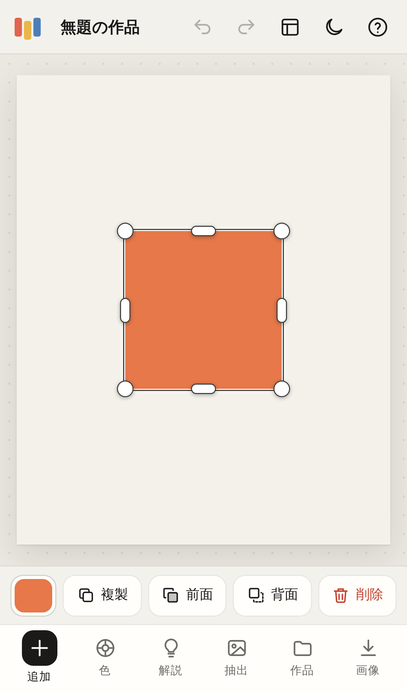
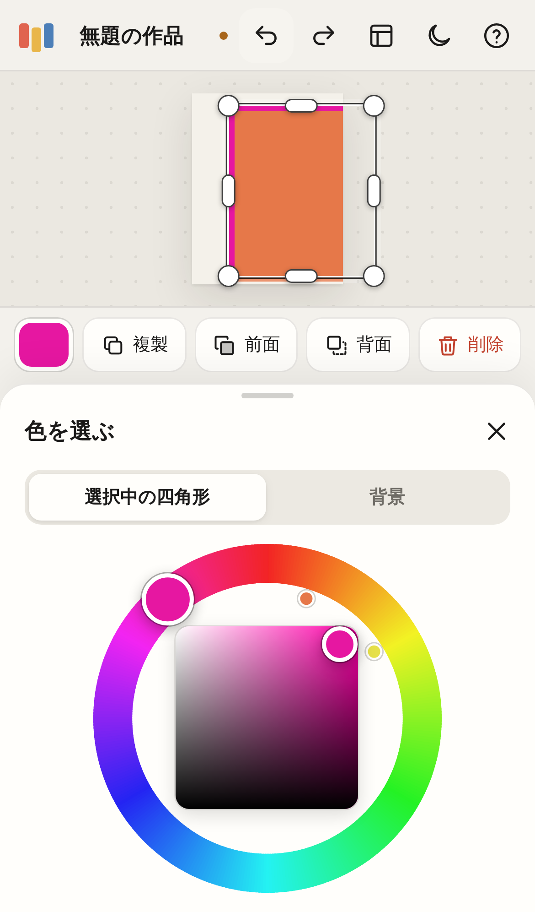
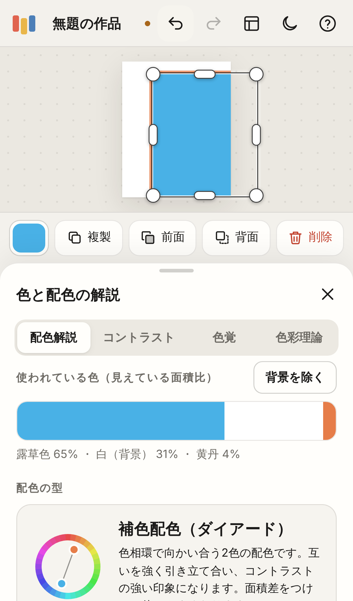
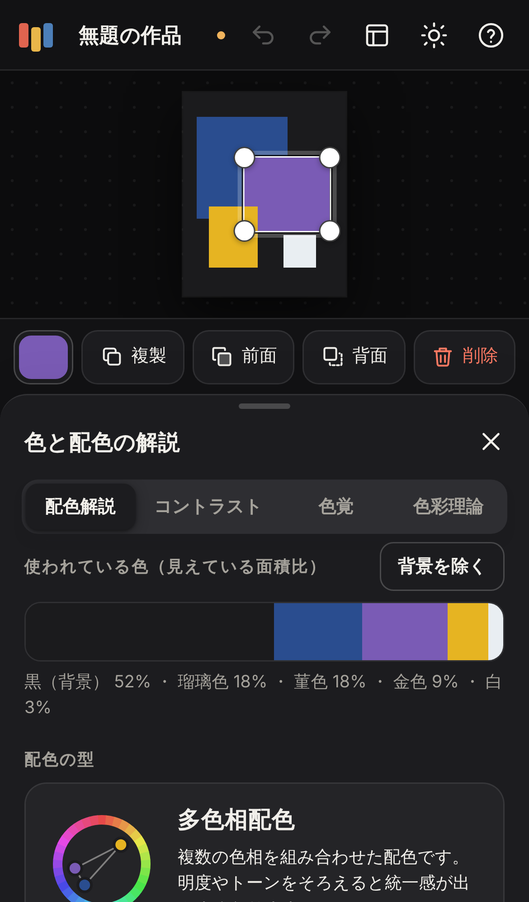
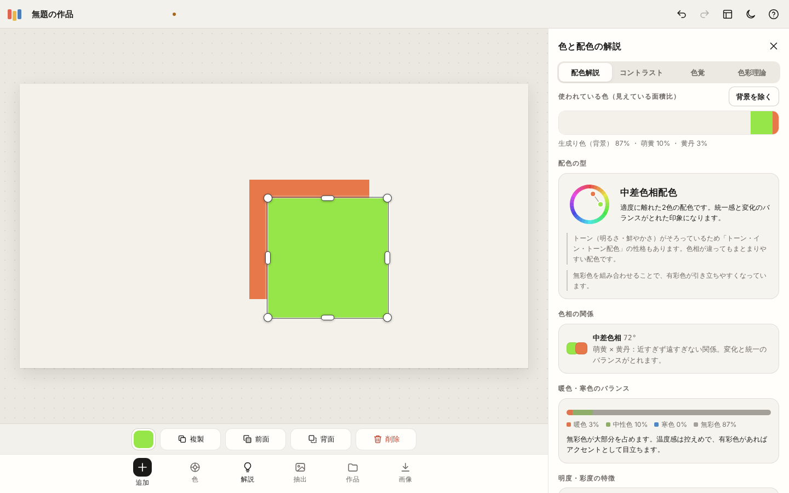

# いろあわせ — Color Combination Studio

色相環から色を選び、色付きの四角形を自由に配置・移動・拡大縮小・重ね合わせしながら配色を楽しむ、スマートフォン向けのWebアプリです。
配色の解説・コントラスト比・色覚シミュレーション・色彩理論の学習機能、画像からの色抽出、作品の保存、PNG出力を備えています。

- **完全無料・静的サイト**：HTML / CSS / JavaScript（ES Modules）のみ。ライブラリ・フレームワーク・外部API・CDN・Webフォント不使用
- **アカウント不要**：データはブラウザの LocalStorage に保存
- **画像は端末内で処理**：色抽出・PNG生成はブラウザ内で完結し、外部へ送信しません
- **GitHub Pages にそのまま公開可能**（ビルド不要）

| スマートフォン | 色の選択 | 配色の解説 | ダークモード |
|---|---|---|---|
|  |  |  |  |



---

## 実装した機能の一覧

### キャンバス・四角形の操作
| 機能 | 内容 |
|---|---|
| 配置 | 初期状態で1つの四角形を配置。「追加」で何個でも追加（上限120） |
| 選択 | タップで選択。選択中は白黒の二重枠＋ハンドルで表示。何もない所をタップで選択解除 |
| 移動 | ドラッグで自由に移動（タッチ・マウス・矢印キー）。キャンバス外へのはみ出しも可（一部は必ず残す） |
| サイズ変更 | 四隅＋各辺の8つのハンドル（タッチ領域44px）。辺ハンドルで縦長・横長の長方形に。2本指ピンチでも拡大縮小 |
| 複製 | 元の四角形の直上に、少しずらして複製 |
| 削除 | 選択中の四角形を削除 |
| 重ね合わせ | 自由に重ねられる。「前面」「背面」で重なり順を変更 |
| 重なった四角形の選択 | 選択中の四角形を重なった場所で再タップすると、その点の下にある四角形を順に選択 |
| 元に戻す／やり直す | すべての操作に対応（最大80段階） |
| キャンバス設定 | 背景色（プリセット・透明・色相環）、縦横比（画面に合わせる / 1:1 / 4:5 / 3:4 / 9:16 / 16:9）、全削除、新規作成 |
| 誤操作防止 | キャンバス・色相環は `touch-action: none` でスクロール／ズームを抑止。iOSのピンチズーム・長押しメニューも抑止 |

### 色の選択
| 機能 | 内容 |
|---|---|
| 色相環 | 円形の色相環。円周のタップ／ドラッグで色相を選択し、選択中の四角形（または背景）にリアルタイム反映 |
| 彩度・明度の四角 | 色相環の内側の四角で、横方向＝彩度、縦方向＝明度をタップ／ドラッグで調整。色相を変えても彩度・明度は保たれる |
| インジケーター | 色相・彩度明度それぞれにつまみを表示。他の四角形の色相も小さな点で表示。四角形を選ぶとつまみがその色に移動 |
| 初期値 | 無彩色から色相を選んだときなどの彩度・明度は `js/config.js` の定数（`WHEEL_SATURATION`, `WHEEL_VALUE`）。数値入力UIは設けていません |
| パレット | キャンバス内の色・画像から抽出した色・白黒をタップで適用 |
| パネル表示中 | 色パネルを開いてもキャンバスは表示されたまま。別の四角形をタップして続けて色を変えられる |

### 色の情報表示
- 色名（JIS慣用色名などから CIEDE2000 で最も近い色名。完全一致でない場合は「≈ 近似」）
- 系統色名（例：あざやかな青）、HEX / RGB / HSV
- **色彩学上の分類**：暖色・寒色・中性色、色相、トーン、明度（L\*）、彩度（C\*）、相対輝度、白・黒とのコントラスト比
- **視覚的な効果（一般に知られる傾向）**：膨張色／収縮色、進出色／後退色
- **一般的なイメージ**：連想語のタグ（文化・個人差があり科学的に確定したものではない旨を明記）

### 配色の解説・学習（「解説」パネル）
- **配色解説**：見えている面積比（重なりを考慮）、配色の型（補色 / 類似色相 / トライアド / スプリット・コンプリメンタリー / テトラード / 同一色相 / 無彩色 など）、トーン・イン・トーン等の補足、色相の関係（同一・類似・中差・対照・補色と角度）、暖色・寒色のバランス、明度・彩度の特徴、ベース／アクセントカラー、組み合わせから受ける印象（高級感・爽やかさ・温かみ・落ち着き・ポップさ・力強さ・神秘的・やさしさ・ナチュラル）と理由
- **スコア化しない**：印象は数値化せず「〜が感じられる可能性があります」と理由付きで表示
- **コントラスト**：任意の2色を選んで WCAG 2.x のコントラスト比を表示し、AA/AAA（通常文字・大きな文字）・非テキスト(3:1)と照合。両方向の文字サンプル、全色の黒文字/白文字比較、全組み合わせの表
- **色覚**：P型・D型・T型・1色覚のシミュレーション（Machado et al. 2009）。キャンバス全体の表示切り替え（データは変更しない）、見え方の比較、区別しにくくなる組み合わせの警告
- **色彩理論**：色の三属性、色相環、補色、類似色、トライアド、スプリット・コンプリメンタリー、テトラード、トーン配色、暖色寒色、明度対比、面積比を図付きで解説（自動で色を変更する機能は持たない）

### 画像からの色抽出
- 端末内の画像を選択（PCはドラッグ＆ドロップも可） → ブラウザ内で縮小・解析（CIELAB空間での k-means++）
- 初期5色（2〜10色で変更可）、面積比つきで表示
- タップで選択中の四角形に適用（未選択なら四角形として追加）、「すべてを四角形として追加」で面積比の帯として配置
- **スポイト**：読み込んだ画像をタップ・なぞると、その位置の色を取得。なぞっている間は指の上に拡大ルーペ（色コード付き）を表示。取った色は「選択中の四角形に適用」「四角形として追加」でき、履歴（最大12色）から選び直しも可能。色パネルのパレットにも表示
- 読み込み失敗・非対応形式・透明画像はエラー表示

### 作品の保存・管理
- 名前を付けて保存 / 上書き保存 / 別名で保存 / 新規作成
- 一覧表示（サムネイルは保存データから描画）・再編集・お気に入り（フィルタ付き）・削除（確認あり）
- 保存内容：各四角形の色・位置・サイズ・重なり順、背景色、縦横比、名前、日時
- 未保存の変更をヘッダーの点で表示、破棄前に確認
- 編集中の内容は自動で下書き保存され、再読み込みしても復元

### 画像出力
- キャンバス部分のみを PNG で出力（長辺2400px、四角形の位置・大きさ・色を正確に反映）
- 背景色の設定・透明背景
- 「PNGを保存」（ダウンロード）、対応端末では「共有・写真に保存」（Web Share API）、プレビュー画像の長押し保存

### テーマ・レスポンシブ
- ライト／ダークモード（初回はOS設定に従い、切り替えは LocalStorage に保存）
- スマートフォン：下部ツールバー＋ボトムシート（上端ドラッグで高さ調整、下スワイプで閉じる）
- タブレット・PC（幅900px以上）：右側にサイドパネル。キーボードショートカット対応

### エラー処理
- LocalStorage の容量超過 → エラー表示し、データは変更しない
- 保存データの破損 → 退避（バックアップキー）して初期化、一部破損は該当作品のみスキップ
- 不正な値（色・座標・ID重複など）は読み込み時に修復・除外（`sanitizeWork`）
- LocalStorage が使えない環境 → メモリ上で動作し警告
- 予期しない例外 → トースト表示してアプリは継続

---

## ファイル構成

```
.
├── index.html              # エントリーポイント
├── manifest.webmanifest    # ホーム画面追加用
├── .nojekyll               # GitHub Pages で Jekyll 処理を無効化
├── assets/icon.svg
├── css/style.css           # すべてのスタイル（ライト/ダーク、レスポンシブ）
├── js/
│   ├── app.js              # 起動・パネル管理・ツールバー・キーボード
│   ├── config.js           # 調整用の定数（色相環の彩度・明度など）
│   ├── store.js            # 状態管理・元に戻す履歴・下書き自動保存
│   ├── canvas.js           # キャンバス描画・タッチ/マウス操作
│   ├── wheel.js            # 色相環＋彩度・明度の四角
│   ├── color.js            # 色変換・WCAG・CIELAB/CIEDE2000・色名・色覚シミュレーション
│   ├── colornames.js       # 色名データ
│   ├── harmony.js          # 配色解説（型・関係・印象）
│   ├── extract.js          # 画像からの色抽出（k-means++）
│   ├── exporter.js         # PNG出力・サムネイル
│   ├── storage.js          # LocalStorage の読み書き・データ検証
│   ├── icons.js / ui.js    # アイコン・トーストなど
│   └── panels/             # 各パネル（色・解説・抽出・作品・書き出し等）
├── tests/
│   ├── unit/               # 計算ロジックの単体テスト（node:test）
│   └── e2e/run.mjs         # ブラウザでの総合テスト（Playwright）
├── docs/screenshots/
├── TESTING.md              # テスト結果
└── package.json            # テスト実行用（アプリの実行には不要）
```

## 調整用の定数（`js/config.js`）

| 定数 | 初期値 | 説明 |
|---|---|---|
| `WHEEL_SATURATION` | 0.68 | 彩度の初期値（0〜1） |
| `WHEEL_VALUE` | 0.9 | 明度の初期値（0〜1） |
| `EXTRACT_COLOR_COUNT` | 5 | 画像から抽出する色数の初期値 |
| `EXPORT_LONG_SIDE` | 2400 | PNG出力の長辺ピクセル数 |
| `MAX_SHAPES` | 120 | 四角形の上限数 |
| `BACKGROUND_PRESETS` | … | 背景色のプリセット |

## データ保存（LocalStorage）

| キー | 内容 |
|---|---|
| `iroawase:works:v1` | 保存した作品の配列 |
| `iroawase:draft:v1` | 編集中の作品（自動保存） |
| `iroawase:settings:v1` | テーマなどの設定 |
| `iroawase:corrupt-backup` | 破損データを検出した場合の退避先 |

作品データ（例）:
```json
{
  "id": "…", "name": "無題の作品", "favorite": false, "createdAt": 0, "updatedAt": 0,
  "background": "#f4f1ea", "aspect": "fit", "artboard": { "w": 1000, "h": 1300 },
  "shapes": [{ "id": "…", "x": 290, "y": 440, "w": 420, "h": 420, "color": "#e67849" }]
}
```
`shapes` の配列順が重なり順（後ろほど前面）です。座標は端末に依存しない論理座標（幅1000）で保存されます。

---

## GitHub Pages への公開手順

1. このリポジトリのファイル一式を、公開したいブランチ（例：`main`）のルートに置きます（ビルド不要）。
2. GitHub のリポジトリ画面で **Settings → Pages** を開きます。
3. **Build and deployment** の **Source** で **Deploy from a branch** を選びます。
4. **Branch** で `main`（公開するブランチ）と `/ (root)` を選び、**Save** を押します。
5. 1〜数分後、同じ画面に表示される URL（例：`https://<ユーザー名>.github.io/color-game/`）にアクセスすると利用できます。
6. スマートフォンで開き、共有メニューの「ホーム画面に追加」を使うとアプリのように起動できます。

> すべてのパスは相対パスのため、`/color-game/` のようなサブパスでもそのまま動作します。
> ES Modules を使用しているため、`index.html` をファイルとして直接開く（`file://`）と動作しません。ローカルでは下記のようにHTTPサーバー経由で開いてください。

## ローカルでの実行

```bash
python3 -m http.server 8000
# → http://localhost:8000/ を開く
```

## テスト

```bash
npm test            # 単体テスト（Node.js 18+、依存パッケージ不要）
npm run test:e2e    # ブラウザ総合テスト（Playwright と Chromium が必要）
```

テスト内容と結果は [TESTING.md](TESTING.md) を参照してください。

## 動作環境

- iOS Safari 15.4 以降、Android Chrome、PC の Chrome / Edge / Firefox / Safari の最新版
- インターネット接続は初回読み込みのみ必要（外部サービスとの通信はありません）

## 色彩情報の扱いについて

- 色名・系統色名は代表的な色名データからの近似です。色名の値は資料によって差があります。
- 暖色・寒色、トーンなどの分類は色彩教育で一般的な区分にもとづく目安です。
- 色の心理的な印象・イメージは一般的な連想の例であり、科学的に確定した効果ではありません。文化・個人・用途によって異なります。
- コントラスト比は WCAG 2.x の計算式によるものです。数値だけでアクセシビリティへの適合や読みやすさを断定することはできません。
- 色覚シミュレーションは近似モデルであり、実際の見え方を正確に再現するものではありません。
